# MANIFIESTO DEL MOTOR DIRECTOR: VIRALFORGE ZENIT V2
**Versión Sellada y Definitiva (Golden Master Engine)**
*Fecha de Consolidación: 9 de Noviembre de 2026*

Este documento sella y formaliza el estándar de producción del **Motor Director Zenit**, el sistema inteligente de postproducción y curaduría que transforma explicaciones pedagógicas de NotebookLM en reels virales de alto impacto para TikTok, Instagram Reels y YouTube Shorts, garantizando una experiencia visual impecable, sin invasión de contenidos educativos y con 0% de rastro de inteligencia artificial.

---

## 1. Los 9 Pasos Canónicos del Motor Director

```mermaid
flowchart LR
    P1["1. Purgado C2PA y Metadatos"] --> P2["2. Corte Preciso Cortinilla"]
    P2 --> P3["3. Zonas Libres Dinámicas"]
    P3 --> P4["4. Alineación Fonética"]
    P4 --> P5["5. Render LaTeX / Visuales"]
    P5 --> P6["6. Ensamblado 3 Escenas"]
    P6 --> P7["7. Watermark: sistemazenit.com"]
    P7 --> P8["8. Cierre Contextualizado"]
    P8 --> P9["9. CTA Oficial: www.sistemazenit.com"]
```



### Paso 1: Purgado de Metadatos y Manifiestos C2PA
- **Operación:** Invocación de `strip_mp4_c2pa_and_metadata` y saneamiento con `-map_metadata -1 -fflags +bitexact`.
- **Estándar:** Verificación de 0 bytes de metadatos C2PA y cero rastros de IA en la estructura de átomos del contenedor MP4.

### Paso 2: Recorte Quirúrgico de la Cortinilla NotebookLM
- **Operación:** Detección fonética de la última palabra hablada por el profesor/narrador de NotebookLM mediante Whisper.
- **Regla de Oro:** El corte `end_trim` se sitúa estrictamente $+0.25$s a $+0.40$s después de la última palabra hablada y siempre antes del fade blanco (que suele iniciar a los $+0.7$s).
- **Garantía:** Nunca se corta la última palabra del docente y el logo final de Google/NotebookLM nunca aparece en pantalla.

### Paso 3: Detección Temporal de Zonas Libres (`ink_mask`)
- **Operación:** Cálculo de la desviación del fondo local (`gray - bg`) y análisis de densidad de trazos.
- **Parámetros:** Margen de seguridad `INK_MARGIN = 24`, ancho mínimo `MIN_ZONE_W = 500`, alto mínimo `MIN_ZONE_H = 110`.
- **Garantía:** Cero invasión de pizarras, ecuaciones químicas, operaciones matemáticas o diagramas originales. Si un contenido ocupa el centro, las tarjetas se desplazan a la franja superior ($y=40..250$) o inferior ($y=980..1520$).

### Paso 4: Alineación Fonética Segundo a Segundo
- **Operación:** Transcripción precisa palabra por palabra con marcas de tiempo en milisegundos (`Word.start`, `Word.end`).
- **Disparadores Temáticos:** Búsqueda con soporte alternativo (`palabra1|palabra2|frase`) para coordinar la aparición visual exactamente cuando el narrador pronuncia el concepto clave.

### Paso 5: Renderizado de Ayudas Visuales (LaTeX Libre de Tofu)
- **Operación:** Tarjetas flotantes oscuras con borde dorado y fórmulas renderizadas mediante `matplotlib` mathtext puro.
- **Regla Tipográfica Estricta:** 
  - Todo símbolo de flecha, transformación o subíndice químico/matemático debe escribirse en LaTeX (`\longrightarrow`, `\overset{...}{\longrightarrow}`, `\Longrightarrow`) con caracteres ASCII puros.
  - El texto plano TrueType debe estar libre de caracteres Unicode exóticos para evitar glifos vacíos (`[]` o tofu).
  - Ajuste dinámico de texto con `textwrap` y reducción progresiva de tamaño tipográfico para asegurar márgenes internos holgados sin cortes de palabra.

### Paso 6: Ensamblado Cinemático Viral de 3 Escenas
1. **Escena 1 (Hook Viral WOW - 8 a 12s):**
   - 3 planos cinemáticos emocionales (*Dolor/Bloqueo* $\rightarrow$ *Pánico del Reloj* $\rightarrow$ *Chispa/Epifanía*).
   - Banner de reto con tag superior dorado, título gigante blanco y open-loop celeste brillante con tildes impecables.
   - Locución hiperenergética de Alex (`es-PE-AlexNeural` a +24%), audio mastering con música auto-ducked (-18dB) y efectos de sonido de impacto y swishes.
2. **Escena 2 (Lección de NotebookLM - 50 a 75s):**
   - Video original perfectamente saneado y estabilizado.
   - Ayudas visuales dinámicas encajadas en las zonas libres sin colisiones.
   - Barra de retención dorada centrada a `[87, 993]` (`x=90, y=1803, w=900, h=24`), con márgenes simétricos de 87px a ambos lados (sin colas negras desbordadas).
   - Píldora de marca de agua superior derecha activa.
3. **Escena 3 (Cierre y CTA WOW - 6 a 8s):**
   - 2 planos cinemáticos de transformación (*Paz/Maestría* $\rightarrow$ *Victoria/Ingreso 100%*).
   - Pantalla de cierre translúcida con la invitación oficial a la plataforma educativa.
   - Locución cálida de Camila (`es-PE-CamilaNeural` a +22%) y efecto celesta chime.

### Paso 7: Marca de Agua Oficial Superior Derecha
- **Estructura:** **Logo Fénix + `sistemazenit.com`** en pastilla oscura translúcida.
- **Tipografía:** 32 px bold blanca brillante.
- **Regla:** Eliminar nombres largos o redundantes ("Academia Zenit" o "Sistema Zenit" repetidos); el foco absoluto es la memorabilidad del **dominio web**.

### Paso 8: Pantalla de Cierre Contextualizada
- **Pregunta:** `¿QUIERES SEGUIR APRENDIENDO MÁS?` (o variación temática: `¿QUIERES DOMINAR ESTEQUIOMETRÍA A OJO?`).
- **Propuesta de Valor:** *"Visita Sistema Zenit, donde aprenderás matemáticas y ciencias."*
- **Llamado Interactivo:** Botón esmeralda `ÚNETE A LA COMUNIDAD` y caja dorada para comentar la palabra clave.

### Paso 9: Enlace Destacado Oficial
- **Dominio:** Caja destacada con bordes cian que muestra en grande: **`www.sistemazenit.com`**.

---

## 2. Protocolo de Rotación de Imágenes Cinemáticas (100% Únicas)

El motor cuenta con un repositorio de 100 imágenes fotográficas cinemáticas organizadas en `assets/emotional_journey/`:
- `01_dolor_bloqueo/` (20 imágenes): Estudiantes frustrados, bloqueados o cansados de noche.
- `02_panico_reloj/` (20 imágenes): Presión del tiempo en simulacros, tarjetas ópticas, sudor y nervios.
- `03_chispa_epifania/` (20 imágenes): Pizarras encendiéndose con fórmulas, libros dorados, deducciones brillantes y renders 3D heroicos (`assets/images/`).
- `04_paz_maestria/` (20 imágenes): Cuadernos impecables, apuntes ordenados, serenidad y respiración profunda.
- `05_victoria_admision/` (20 imágenes): Constancias de ingreso, abrazos familiares, saltos de alegría y carnets universitarios.

**Regla de Selección:**
Ningún reel debe compartir la misma terna de Hook ni el mismo par de CTA que otro. Cada video dispone de su propia identidad visual adaptada a la naturaleza de la clase.

---

## 3. Instrucciones de Ejecución para Nuevos Lotes

Para procesar un nuevo video o lote de videos manteniendo el estándar sellado:

```powershell
# Ejecución completa del lote estándar (Reels 1 al 10):
.\.venv\Scripts\python.exe scripts/produce_zenit_batch_remaining.py --reels 1 2 3 4 5 6 7 8 9 10

# Ejecución de un único reel específico:
.\.venv\Scripts\python.exe scripts/produce_zenit_batch_remaining.py --reels 10
```

### Checklist Automatizado de Calidad (QA)
1. `c2pa_detected == False` y 0 bytes de metadatos IA.
2. Cero glifos tofu `[]` en tarjetas y títulos.
3. Barra de progreso confinada a `[87, 993]` sin colas negras al borde derecho.
4. Locución final de lección escuchada completa sin cortes antes del CTA.
5. Cero fotogramas del logo de Google/NotebookLM al final.
6. Watermark superior: Logo + `sistemazenit.com`.
7. Outro CTA: `www.sistemazenit.com`.
